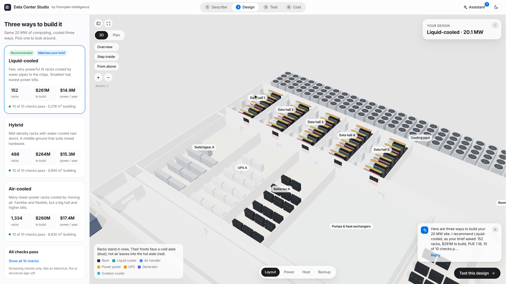
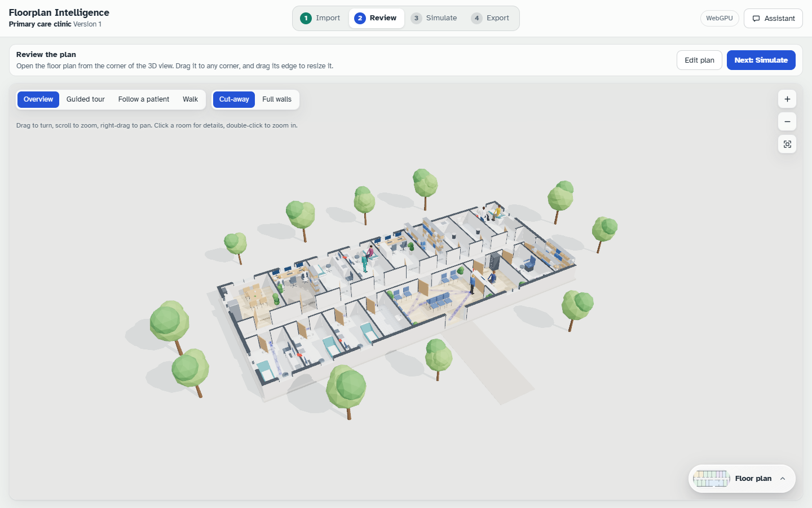
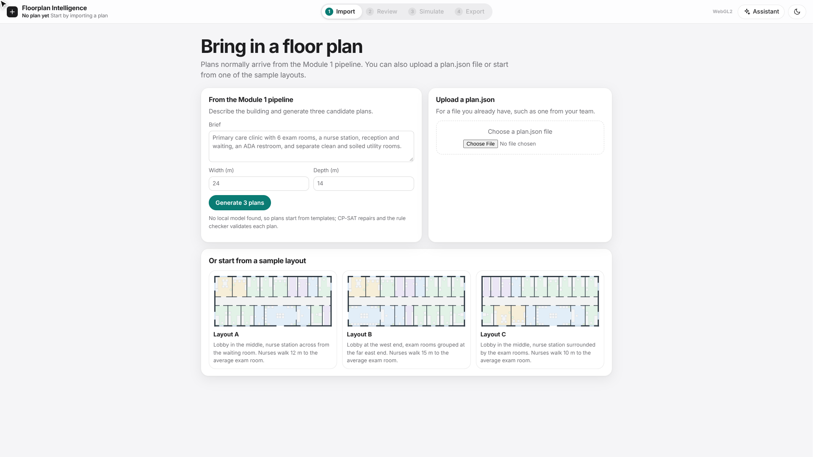
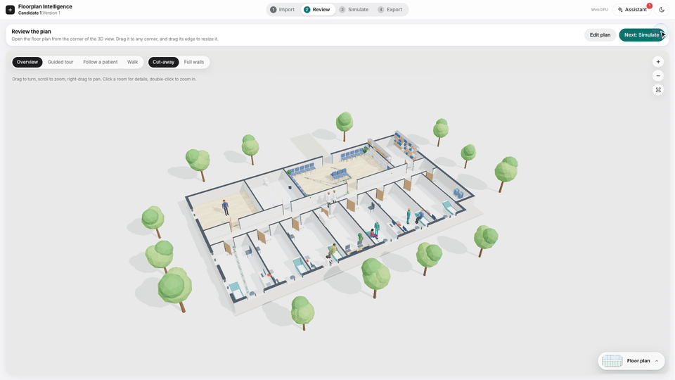
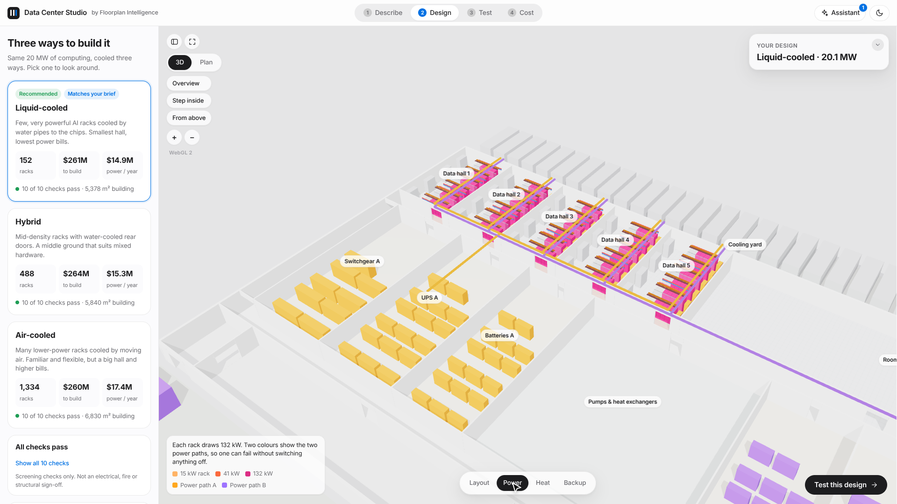
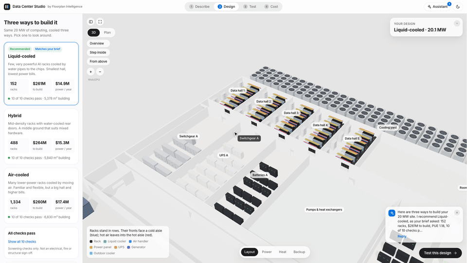
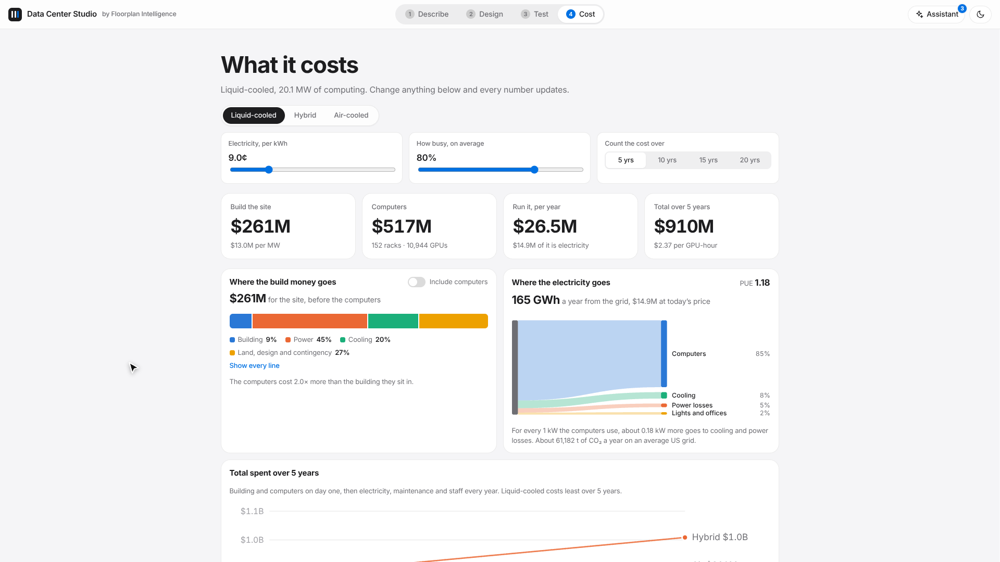
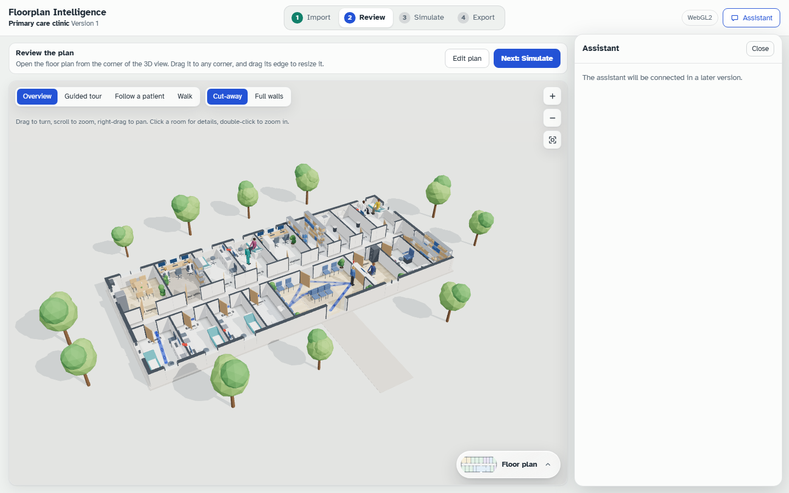

# Floorplan Intelligence

[](LICENSE)
[](https://huggingface.co/VenuArvind/aegisplan-nemotron-nano-9b)
[](https://huggingface.co/VenuArvind/aegisplan-nemotron-nano-9b-gguf)

**Brief in, building out.** Describe a building in a sentence. You get valid floor plans, a 3D model you can walk through, a simulation of how the building performs, and a file for Blender or NVIDIA Omniverse.

> The LLM proposes. The solver proves. The simulator tells you if it works.

| | |
|---|---|
| **Hackathon** | Nebius × NVIDIA Global AI Hackathon 2026 |
| **Track** | Best Apps and Agents |
| **Team** | Arunachalam · Sarvesh · Venu Arvind |
| **Demo video** | _Coming soon_ <!-- Replace with the YouTube link: [Watch on YouTube](https://youtu.be/...) --> |
| **License** | [MIT](LICENSE) |



---

## Contents

- [The problem](#the-problem)
- [How it works](#how-it-works)
- [Features](#features): [Clinic](#1-clinic-generate-review-simulate-export) · [Data Center Studio](#2-data-center-studio-describe-design-test-cost) · [Assistant](#3-the-assistant-shared-by-both-apps)
- [Built with NVIDIA and Nebius](#built-with-nvidia-and-nebius)
- [Measured results](#measured-results)
- [Quick start](#quick-start)
- [Architecture](#architecture)
- [Testing](#testing)
- [Limitations](#limitations)
- [Roadmap](#roadmap)
- [Team and license](#team)

---

## The problem

1. **Early building design is slow and depends on experts.** Turning a brief like "a primary-care clinic with 6 exam rooms" into a first plan takes an architect days. Testing whether that plan works on a busy day takes longer, and it rarely happens before construction.
2. **Language models alone can't be trusted with geometry.** Asked to draw a plan, an LLM overlaps rooms, narrows corridors, forgets the brief and claims compliance it didn't check. We measured this on our own fine-tuned model. Without a grammar it ignores its training format. With one, the room list is right but the coordinates don't fit the site.
3. **Solvers alone can't read a brief.** A constraint solver gives exact geometry, but it can't interpret "nurse station among the exam rooms" or "enough for 6,000 GB200s".
4. **Plans are judged on paper, not on how they run.** Owners care about how long patients wait, how far nurses walk, and whether a data center survives a cooler failure. Those questions get answered late, if at all.

## How it works

The work is split by what each tool does best:

| Job | Tool | Why |
|---|---|---|
| Read the brief, write the room program, read edits | **NVIDIA Nemotron Nano 9B v2**, fine-tuned (QLoRA + GRPO), grammar-constrained, running locally | It understands language. It is never trusted with coordinates. |
| Exact geometry, or a proof that a request is impossible | **Google OR-Tools CP-SAT** | No overlaps, locked rooms kept, minimal moves. When a request is infeasible, it names the conflicting rooms. |
| Say what passed and why | **Rule checker** with citations (ADA, FGI, IBC for clinics; ASHRAE, NEC, NFPA for data centers) | It reports what it checked, never a blanket "compliant". |
| Show it, run it, price it | **Browser app**: WebGPU 3D, deterministic simulation, failure testing, cost model | Everyone sees the same geometry, and the numbers are reproducible. |
| Talk to it | **Tool-calling assistant** (Nemotron, or a built-in fallback) with web search | It answers from the app's live numbers and acts through the same functions as the buttons. |

**Same model, same solver, same viewer: a new building type is a configuration, not a new product.** We show this with two very different buildings, an outpatient clinic and an AI data center.

---

## Features

### 1. Clinic: generate, review, simulate, export

Four steps: **Import → Review → Simulate → Export.**



**Generate from a brief**
- Type a brief and a site size, then press **Generate 3 plans**.
- Three candidate layouts come back (west, centre and east entrance), ranked by the checks they pass. Each is tagged with whether Nemotron or the fallback parser drafted it.
- Each candidate shows **9 cited plan checks** (geometry, ADA 404.2.3 / 403.5.1 / 304.3, FGI, IBC 1017, boundary). Each check reports its measured value, the required value and the source.
- You can also upload any plan.json v0.1, or start from three sample layouts. The viewer needs only rooms and doors. It derives the **walls, windows, furniture, entrance and a walkable grid** itself.



**Review in 3D**
- three.js with **WebGPU**, falling back to **WebGL2** automatically.
- **Camera modes:**
  - Overview (orbit).
  - **Guided tour**, which follows a patient's visit with captions.
  - **Follow a patient** during a simulated day.
  - **Walk**: first person with collision, by keyboard or on-screen pad.
- Cut-away or full walls, low-poly furniture per room type, and animated people.
- A **floor plan dock** (draggable, resizable 2D SVG). Click a room to fly there.
- **Route overlays:** the patient path, nurse walks, and the longest way out.
- A **room card** shows area, size, purpose and what's happening in the room now.

**Edit, and re-solve in plain language**
- Swap rooms, rename them, and place furniture; walking routes re-plan around it. Versions support undo.
- **"Ask the plan generator"** handles bigger changes. For example, "Make the waiting room 20% bigger, keep the restrooms fixed": AegisPlan holds the edited room at its new size while CP-SAT repairs the rest, and the result returns as a new version.
- **Impossible requests are proven, not faked.** The rooms in the way turn red in 3D, with the arithmetic: "Waiting Area 1 would be 35 m wide, and the building is 24 m wide."



**Simulate clinic days**
- A **discrete-event simulation** (event heap, seeded PRNG) of patients, nurses, providers and receptionists. It is **fully deterministic**: the same seed gives the same day.
- **Walking time comes from real path lengths** (A* on the walkable grid), so moving the nurse station really changes how far nurses walk.
- **Scenarios are typed blocks:**
  - hours and staff shifts;
  - appointments and no-shows, walk-ins with arrival patterns, group arrivals;
  - visit types and visit steps;
  - breaks, staff out, closed rooms;
  - **When/Then rules**, e.g. "when more than 3 people wait at the desk for 10 min, call in a receptionist".
- **Presets:** Normal Tuesday, Flu-season Monday, Short-staffed day. **Quick setup** uses − / + steppers for staff and patients.
- **Run 20 days** to get a **verdict**: *Handles it*, *Busy, but it copes*, or *Struggles*. Results include:
  - the **bottleneck**, with utilisation bars;
  - average and 1-in-10 waits, time in clinic and nurse walking distance, each with a low–high range across days.
- **The 3D plays the typical day** with a transport bar (1×–300×, scrubbable timeline), a foot-traffic heat layer and waiting-time dots.
- **Try a range of values:** sweep nurses, providers or patients and compare the verdicts. Every run is kept in **History**.
- **Compare layouts:** run the same day on every candidate side by side.


**Export**
- **One .zip for Blender:** `clinic.glb` (one node group per room), `plan.json` with edits and check results, `plan.svg`, a `build_in_blender.py` script, a Claude Code skill and a README.

### 2. Data Center Studio: describe, design, test, cost

The second domain, built to show the pipeline is general. Four steps: **Describe → Design → Test → Cost**, at `/datacenter`.

**Describe**
- Type one sentence, e.g. *"20 MW AI factory, liquid cooled, N+1 cooling, 2N power, 9¢/kWh, 5 years"*. A deterministic **brief reader** extracts MW, GPU counts, cooling type, redundancy, electricity price and years.
- **Nemotron** (`/api/dc/brief`) fills in what the sentence implies but doesn't state, such as "enough for 6,000 GB200s" or "Tier III". **Numbers you type always win**, and the UI tags anything the model added.

**Design: three options, every part placed**

| Option | Rack class | Rack power |
|---|---|---|
| Liquid | GB200 NVL72-class AI rack | 132 kW |
| Hybrid | 4× HGX H200-class servers with rear-door coolers | 41 kW |
| Air | L40S-class inference servers | 15 kW |

- A deterministic building generator lays out the full site:
  - the generator yard and support rooms;
  - the power row (electrical, UPS, battery, mechanical);
  - the data halls and the cooling yard.
- **Hall filler:** every rack row faces a cold aisle with hot-aisle containment. Cooling units are sized for N, N+1 or 2N. The power design includes A/B power paths, PDUs, UPS, batteries, switchgear, transformers and generators.
- **Ten cited design checks:** rack orientation, aisle widths, any-one-cooler loss, any-one-power-unit loss, generator capacity, NEC 110.26 working space, floor loading, NFPA battery separation, the delivery route, and A/B separation.
- **CP-SAT proves the room layout** (`/api/dc/check`): no overlaps, and every door joins rooms that touch. It then searches for the narrowest building that still works. The proof takes about 30 ms and returns OPTIMAL on all six reference designs.
- **Four lenses** in 2D and 3D: **Layout**, **Power** (racks coloured by kW, paths A/B), **Heat** (temperature field, animated airflow) and **Backup**. Click any part to see an inspector card with its numbers and a plain-language explanation.



**Test: break it and see what keeps running**
- Six **what-ifs**: a cooler breaks, a power path fails, the grid goes down, a heat wave (40 °C), 105% load, and the worst day (grid down, a generator fails, 42 °C).
- **Break any part** from its card or by asking the assistant. **Fix everything** restores it. **Play a day** runs 24 hours of temperature and load. **Test every part** fails each part in turn and reports which single failures hurt.
- Each status explains itself in one sentence: "the 3 remaining coolers carry 2,400 kW; the hall needs 2,112 kW".
- A **thermal estimate** solves an air-temperature field per hall on a 600 mm grid, calibrated to ASHRAE recommended (27 °C) and allowable (32 °C) inlet temperatures. It is labelled as an estimate, not CFD.



**Cost**
- The **build cost** by group, with **IT hardware** shown separately because it often exceeds the building.
- The **running cost per year**, from electricity × PUE, maintenance and staff.
- An **energy Sankey** showing where every kWh goes, and **total cost** over the years.
- **$/kW-month**, **$/GPU-hour** and **CO₂ per year**, plus a compare table across the three options.
- **14 editable, sourced assumptions.** Change electricity to 15¢ and everything recomputes.



**Export:** **OpenUSD (.usda) for NVIDIA Omniverse**, with one PointInstancer per equipment kind so thousands of racks stay light, and every id, kW and power path stored as a custom attribute. A lossless JSON export is also available.

### 3. The assistant, shared by both apps



- A chat panel docked in both apps (⌘J). **It never guesses a number.** It calls tools that read the app's live state, quotes what they return, and **acts through the same functions as the buttons**.
- **About 20 data center tools:**
  - read the overview, options, costs, status and checks;
  - find parts by everyday names ("cooler 2", "UPS B1"), break them, fix everything, run what-ifs, test every part;
  - show a lens, change a cost assumption, design a new site;
  - prove the layout with CP-SAT, export USD.
- **12 clinic tools:** show a room, set staff, load a preset day, run the simulation, compare layouts, switch the camera, and more.
- **Web search** (Tavily) for facts outside the app, such as building codes, equipment and prices. Answers cite their sources as links. App numbers always come from the app's own tools.
- **It speaks first:**
  - it recommends a design and explains why;
  - on the Test step, it explains what to try;
  - when something you broke takes rows down, it explains the cause;
  - after a simulation run, it reports the verdict and the bottleneck.
- **Providers:**
  - **Nemotron** through the server's `/api/chat` proxy, which streams OpenAI-format tool calls over SSE. **Keys never reach the browser.**
  - A **built-in** mode that needs no model and answers common questions instantly. The app works fully offline.
- Answers link rooms and parts as `[Exam 2](#exam_room_2)`. Clicking the link flies the 3D there.

---

## Built with NVIDIA and Nebius

**NVIDIA Nemotron Nano 9B v2, fine-tuned and published**
- Fine-tuned with **QLoRA (r = 32, α = 64) + GRPO**:
  - SFT on 400 plans, with 50 for validation;
  - 500 GRPO prompts with **4 verifiable rewards**: format, no overlap, connectivity and regulatory checks.
- Published on Hugging Face:
  - [`VenuArvind/aegisplan-nemotron-nano-9b`](https://huggingface.co/VenuArvind/aegisplan-nemotron-nano-9b): merged BF16, 18 GB;
  - [`…-gguf`](https://huggingface.co/VenuArvind/aegisplan-nemotron-nano-9b-gguf): Q8_0 at 9.2 GB, and **Q4_K_M at 5.5 GB**, the version we run.
- **Grammar-constrained decoding** (GBNF in llama.cpp) guarantees that every line the model writes is valid FML, our floor-plan language.
- The model runs **locally on Apple Silicon Metal** (all layers on GPU, about 5.8 GB of memory), so no data leaves the machine.
- **Program-first generation** is a design decision backed by our own test. Constrained Nemotron writes a reliable *room program* but unreliable geometry, so Nemotron decides *what* to build and CP-SAT decides *where*.

**Nemotron's tool calling powers the assistant** through any OpenAI-compatible endpoint:
- the NVIDIA API catalog / NIM (`NVIDIA_API_KEY`, default `nvidia/nvidia-nemotron-nano-9b-v2`);
- **Nebius Token Factory** or a self-hosted vLLM / llama.cpp server (`AEGIS_CHAT_URL`, `AEGIS_CHAT_KEY`, `AEGIS_CHAT_MODEL`).

**NVIDIA Omniverse / OpenUSD:** Data center designs export as USD with PointInstancers and custom attributes. The rack classes are modelled on NVIDIA hardware: GB200 NVL72 (132 kW), HGX H200 and L40S.

---

## Measured results

Every number below was measured or read from the code. The raw benchmark is in [docs/BENCHMARK.md](docs/BENCHMARK.md) (`make bench`).

**Pipeline benchmark (clinic, 2026-10-25, Apple M4 Pro, model off)**

| Measure | Result |
|---|---|
| Feasible briefs accepted (every applicable check passes) | **20 / 20** |
| Brief fidelity (every named room type and stated count present) | **20 / 20** |
| Latency for 3 candidates, p50 / max | **0.04 s / 0.13 s** |
| Impossible requests answered with a conflict core instead of a plan | **5 / 5** |
| With Nemotron on (3 candidates, all layers on Metal) | **~47 s** per request |
| API cost per plan when run locally | **$0** |

**The simulator separates layouts.** These numbers are for a flu-season Monday, averaged over 5 simulated days:

| Measure | West entrance | Centre entrance | East entrance |
|---|---|---|---|
| Average wait | 13.4 min | **11.5 min** | 14.6 min |
| Nurse walking per day | 2.0 km | **1.4 km** | 1.4 km |

**Data center:** the CP-SAT layout proof takes **~30 ms** and returns OPTIMAL on all six reference designs.

---

## Quick start

Requires **Python 3.12**, [uv](https://github.com/astral-sh/uv) and **Node ≥ 20**.

```bash
git clone https://github.com/Nemo-boys/floorplan-visualization.git
cd floorplan-visualization
make setup      # Python venv (aegis/.venv) + npm install
make test       # pytest + typecheck, lint and Vitest
make dev        # builds the viewer and serves viewer + API on http://127.0.0.1:8000
```

| Page | URL |
|---|---|
| Clinic (generate, review, simulate, export) | http://127.0.0.1:8000 |
| Data Center Studio | http://127.0.0.1:8000/datacenter |

**Everything works without a model or any keys.** Plans come from the deterministic brief parser, and the assistant answers in built-in mode. To turn on the optional parts:

| Feature | How |
|---|---|
| Local fine-tuned Nemotron for generation | `aegis/.venv/bin/python aegis/scripts/download_from_hf.py`. The GGUF lands in `aegis/checkpoints/` and is used automatically. |
| Nemotron for the assistant and the data center brief reader | `NVIDIA_API_KEY=nvapi-... make dev` (NVIDIA API catalog), or `AEGIS_CHAT_URL=<OpenAI-compatible /v1 URL> AEGIS_CHAT_KEY=... AEGIS_CHAT_MODEL=<model id> make dev` (Nebius Token Factory, NIM, vLLM, llama.cpp) |
| Web search in the assistant | Put `TAVILY_API_KEY=tvly-...` in `aegis/.env` (gitignored, read at server start) or in the environment |

API keys stay on the server. `/api/chat` and `/api/search` proxy the requests, and the browser runs the tools. See `aegis/aegisplan/chat.py` and `aegis/aegisplan/search.py`.

**Try it:**
1. **Clinic.** Use the default brief and press **Generate 3 plans**, then open the top candidate.
2. In **Review**, start the guided tour.
3. In **Simulate**, choose Flu-season Monday, then **Run 20 days**.
4. Compare the layouts. Then go to Review → Edit → **Ask the plan generator**: "Make the waiting room 20% bigger, keep the restrooms fixed".
5. **Data center.** Open `/datacenter` and type "20 MW AI factory, liquid cooled, N+1 cooling, 2N power".
6. Switch to the Heat lens. In Test, press "The grid goes down", then ask the assistant "Can it survive any one failure?"

A full 3-minute walkthrough is in [docs/DEMO.md](docs/DEMO.md).

**Run each half on its own:**

```bash
cd aegis && .venv/bin/uvicorn aegisplan.server:app --port 8000   # API (works without model weights)
cd viz && npm run dev                                               # viewer with hot reload on http://localhost:5173
```

**Convert a generated plan for the viewer:**

```bash
cd aegis && .venv/bin/python -m aegisplan.export_viz plan.json -o viz-plan.json   # then use Upload in the viewer
```

---

## Architecture

```
 Brief + site size + locked rooms
        │
        ▼
 1. DRAFT    Nemotron Nano 9B v2 (QLoRA + GRPO), llama.cpp GGUF on Metal, GBNF-constrained
             → the room program in FML.  No model: a deterministic brief parser.
        ▼
 2. LAY OUT  program.py: double-loaded corridor, 3 entrance variants (west / centre / east)
        ▼
 3. REPAIR   OR-Tools CP-SAT on a 100 mm grid: no overlap, locks kept, minimal movement;
             INFEASIBLE → conflict core naming the rooms in the way
        ▼
 4. CHECK    validator.py: 9 cited rules; candidates ranked by checks passed
        ▼    export_viz.py → plan.json v0.1 (y flipped, room ids kept, checks + provenance)
 5. VIEW     Browser: 3D review, walkthrough, discrete-event simulation, compare, edit, export
```

**Runtime:** one FastAPI process on one port, with no CORS.

| Path | What it serves |
|---|---|
| `/` | the clinic app (`viz/dist`) |
| `/datacenter` | Data Center Studio |
| `/api/pipeline` | brief → 3 checked candidates |
| `/api/edit_text` | plain-language edit → repaired new version |
| `/api/chat` | streamed model proxy with tool calls |
| `/api/search` | Tavily web search |
| `/api/dc/brief` | Nemotron reads a data center brief |
| `/api/dc/check` | CP-SAT layout proof |

Without the server, both apps still run as static sites, on sample plans, in-browser design generation and the built-in assistant.

| Folder | What it is |
|---|---|
| [`aegis/`](aegis/) | AegisPlan (Python 3.12): generation, grammar, layout synthesis, CP-SAT repair, rule checker, plain-language edits, FastAPI, chat and search proxies, data center endpoints |
| [`viz/`](viz/) | The browser apps (TypeScript, Vite, plain DOM, three.js WebGPU): the clinic viewer (`src/`) and Data Center Studio (`src/dc/`), plus the shared assistant (`src/assistant/`) |
| [`contracts/`](contracts/) | How AegisPlan's plan format maps to the viewer's plan.json |
| [`docs/`](docs/) | Demo script and measured benchmark |
| [`presentation/`](presentation/) | Write-ups, key numbers, screenshots and the demo video kit |

**Tech stack:**

| Layer | Technologies |
|---|---|
| Model | NVIDIA Nemotron Nano 9B v2, Unsloth (QLoRA + GRPO), llama.cpp / llama-cpp-python (GGUF, Metal), GBNF grammars |
| Solver and backend | Google OR-Tools CP-SAT, FastAPI, Pydantic v2, httpx |
| Frontend | TypeScript (strict), Vite, three.js 0.186 (WebGPU / WebGL2) |
| Search | Tavily |
| Export | glTF/GLB, ZIP, Blender Python, SVG, OpenUSD, JSON |

The full technology list is in [presentation/10-tech-stack.md](presentation/10-tech-stack.md).

## Testing

```bash
make test                                   # everything below except Playwright
cd aegis && .venv/bin/python -m pytest -q   # 64 tests
cd viz && npm run check                     # typecheck + lint + 154 Vitest unit and golden tests
cd viz && npm run test:e2e                  # Playwright end-to-end (npx playwright install chromium first)
```

**Python tests:**
- The adapter is checked on all 500 dataset plans.
- CP-SAT repair, plain-language edits and the data center endpoints.
- The chat and search proxies, against mocked transports.
- Tests never load the model.

**Viewer tests:**
- Golden files freeze the simulator's exact numbers.
- Parity tests guard the DOM and CSS against the approved reference design.
- Generated plans are loaded, path-found and simulated.
- The data center engine and the assistant's agent loop.

## Limitations

- **Not a licensed design or code sign-off.** The checker implements 9 clinic rules and 10 data center checks. It reports "passes N of M implemented checks", never "compliant".
- **The model is not trusted with coordinates.** This is by design, and backed by our own test (see [How it works](#how-it-works)).
- **Generation with the model is slow on a laptop**: about 47 s for 3 candidates on an M4 Pro. A hosted Nemotron is the path to faster generation.
- Layouts are **single-storey and orthogonal**.
- **Thermal is an estimate, not CFD.** Pass/fail comes from capacity arithmetic.
- **Costs are planning estimates** from stated, editable assumptions, not quotes.

## Roadmap

1. Domain packs as configuration on the Python side (`domains/clinic`, `domains/datacenter`), opening the way to schools, offices, labs and hospitals.
2. Faster generation with hosted Nemotron, a shorter program format and caching by brief.
3. Multi-storey and non-rectangular sites, windows and exterior walls in the solver, and DXF export.
4. Richer Omniverse output (materials, per-rack variants) with live sync of failure states into a digital twin.
5. Staffing optimisation: search for the cheapest staffing that still "Handles it".

---

## Team

**Arunachalam · Sarvesh · Venu Arvind**, for the Nebius × NVIDIA Global AI Hackathon 2026, Best Apps and Agents track.

`aegis/` and `viz/` were brought in with `git subtree`, so each one's history is in `git log -- aegis/` and `git log -- viz/`. The plan and status are in [PLAN.md](PLAN.md).

## License

Released under the [MIT License](LICENSE). Copyright © 2026 Arunachalam, Sarvesh and Venu Arvind.
