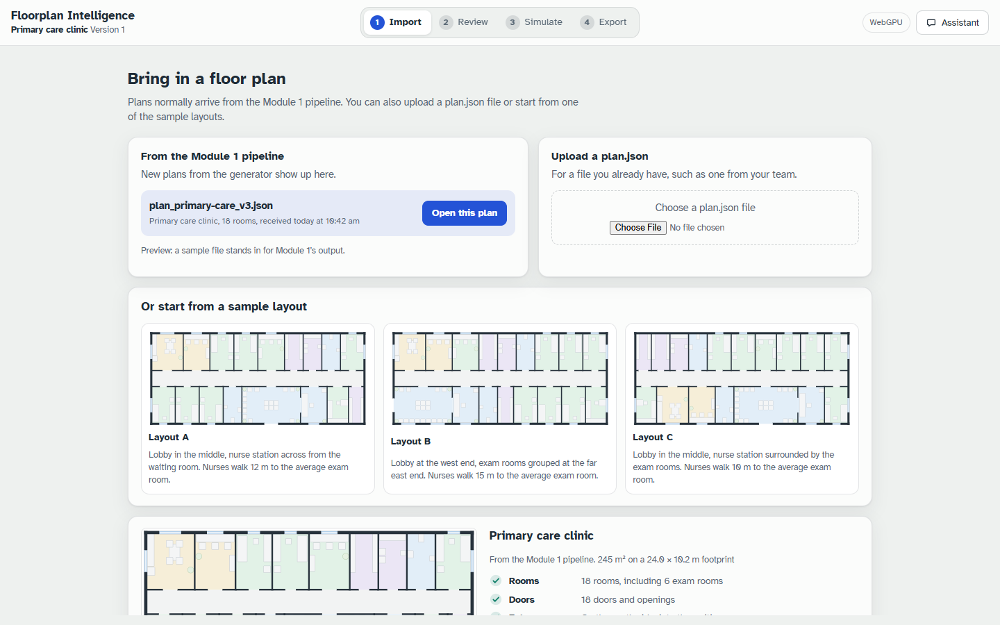
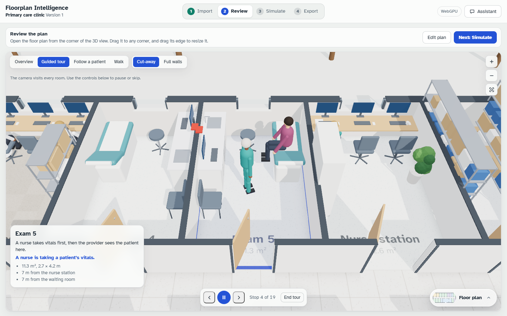
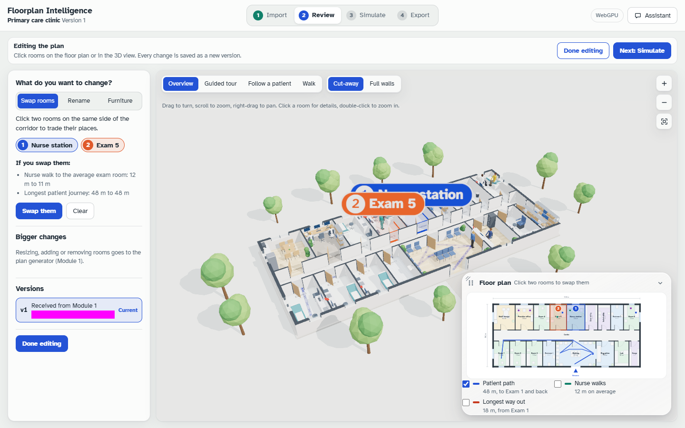
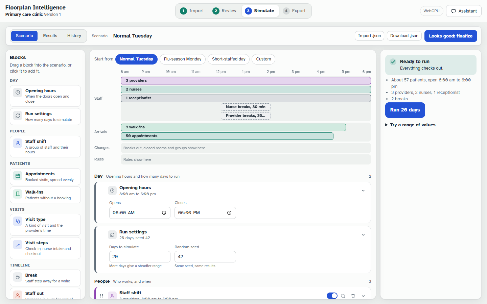
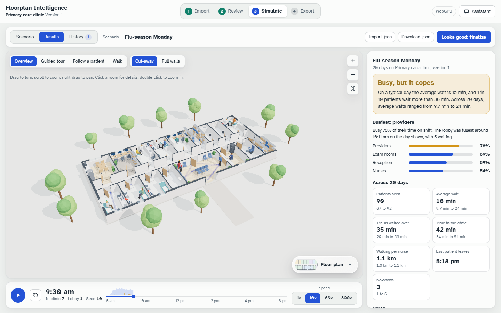
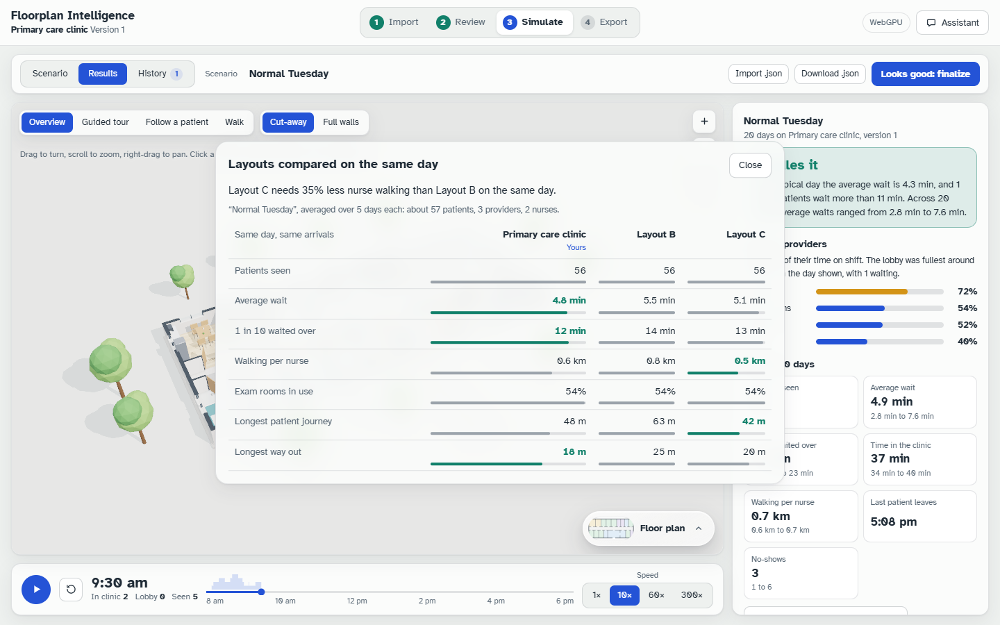
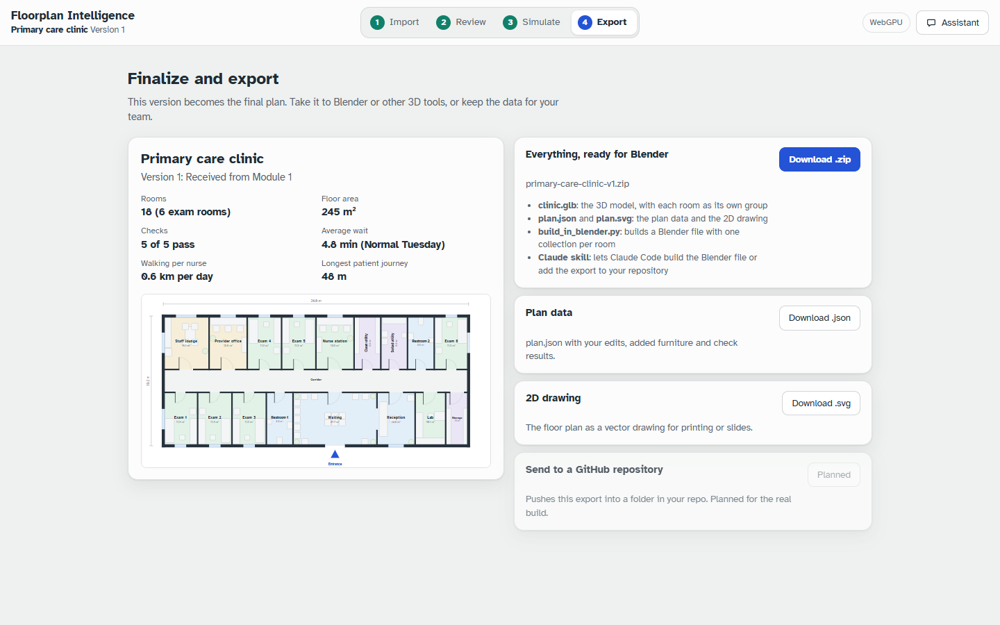
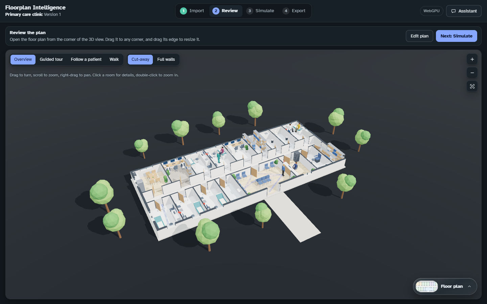
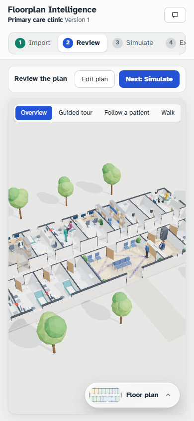

# Final screenshots

The app at the end of the build, in Google Chrome with WebGPU, 1440×900 (plus one in dark mode and one on a phone). They were taken by `tests/visual/capture.ts` with the day paused at 9:30 am. The magenta bars hide times and dates, which change from run to run.

| | |
|---|---|
|  Import |  Review |
|  Guided tour |  Edit: swap |
|  Scenario |  Results |
|  Layout comparison |  Export |
|  Dark mode |  Phone |

All 54 screenshot states, in three browsers, are produced by `npm run test:visual`, `test:visual:webgpu` and `test:visual:webgl`.
